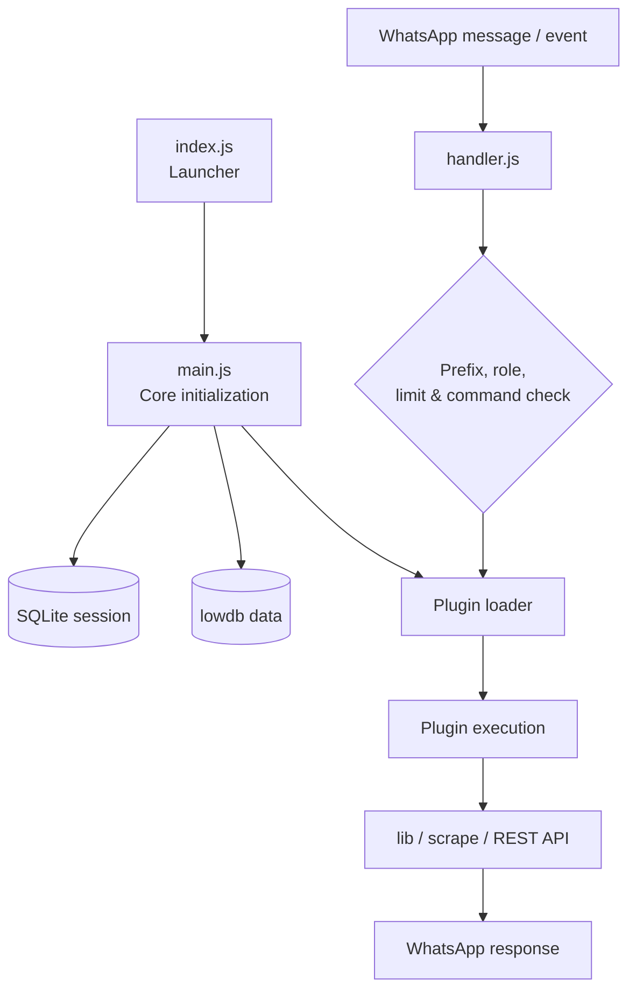

<div align="center">


<a href="https://github.com/Lynx-decode/ERINE-AI">
  
</a>

# ERINE-AI • ELYRINE

### WhatsApp Automation System · Multi-Device · Node.js ESM


**An extensible WhatsApp automation project powered by 
`elyra-baileys`.**

ELYRINE menggabungkan AI, pencarian, downloader, pengolahan media, sticker maker, utilitas grup, sistem limit dan membership, manajemen saluran, serta kontrol owner dalam satu ekosistem bot WhatsApp Multi-Device.

[](https://nodejs.org/)
[](https://github.com/Lynxcode-id/elyra-baileys)
[](package.json)
[](https://www.whatsapp.com/)
[](LICENSE)

[](https://github.com/Lynxcode-id/elyrine/stargazers)
[](https://github.com/Lynxcode-id/elyrine/forks)
[](https://github.com/Lynxcode-id/elyrine/issues)
[](https://github.com/Lynxcode-id/elyrine/commits/main)

**Developed by Lynx Decode · Elyra Labs · INF Project**

</div>

<details open>
<summary><strong>🧭 Navigasi dokumentasi — klik untuk membuka atau menutup</strong></summary>

<div align="center">

[📌 Tentang](#tentang-elyrine) · [📊 Informasi project](#informasi-project) · [✨ Fitur](#fitur-utama) · [🗂️ Kategori plugin](#kategori-plugin) · [📜 Perintah](#referensi-perintah) · [💎 Tier & limit](#sistem-tier-limit-dan-expired) · [🔣 Prefix](#prefix-dan-no-prefix)

[🏗️ Arsitektur](#arsitektur-project) · [🚀 Instalasi](#instalasi) · [⚙️ Konfigurasi](#konfigurasi) · [🧩 Plugin](#sistem-plugin) · [🛡️ Keamanan](#stabilitas-privasi-dan-keamanan) · [📦 Dependency](#teknologi-dan-dependency-utama) · [🤝 Kredit](#kredit-dan-kontributor) · [📄 Lisensi](#lisensi) · [📬 Kontak](#kontak-developer)

</div>

</details>

---

## Tentang ELYRINE

**ERINE-AI • ELYRINE** adalah framework bot WhatsApp Multi-Device yang dikembangkan menggunakan **Node.js dengan standar ES Modules (ESM)**. Proyek ini dirancang sebagai sistem otomasi modular: fitur dipisahkan ke dalam plugin, fungsi inti dikelola melalui library internal, sedangkan koneksi WhatsApp ditangani oleh engine **`elyra-baileys`**, custom fork Baileys yang dikembangkan untuk kebutuhan ekosistem ERINE-AI.

ELYRINE bukan sekadar kumpulan command. Struktur proyeknya mencakup pengelolaan sesi, database pengguna dan grup, sistem role, kuota harian, masa aktif premium/VIP, masa sewa grup, pemrosesan media, integrasi REST API, serta mekanisme pemeliharaan bot.

Tujuan pengembangannya adalah menyediakan satu fondasi bot yang:

- **Modular:** fitur dapat ditambah, dihapus, atau diperbarui melalui sistem plugin.
- **Fleksibel:** prefix, konfigurasi, identitas bot, API, dan hak akses dapat disesuaikan.
- **Terorganisasi:** command dikelompokkan berdasarkan kategori agar mudah dirawat.
- **Terintegrasi:** menyediakan banyak fungsi dalam satu koneksi WhatsApp.
- **Berorientasi stabilitas:** memiliki pengelolaan proses, sesi SQLite, pemantauan memori, dan mekanisme pemulihan koneksi.

> ELYRINE dikembangkan untuk penggunaan, pembelajaran, dan pengembangan non-komersial sesuai ketentuan lisensi proyek. Baca bagian [Lisensi](#lisensi) sebelum menggunakan atau mendistribusikannya.

## Informasi project

| Informasi | Detail |
|---|---|
| Nama proyek | **ERINE-AI • ELYRINE** |
| Jenis | WhatsApp Automation / Multi-Device Bot |
| Runtime | Node.js `>=20` |
| Module system | ES Modules (`"type": "module"`) |
| Entry point | `index.js` |
| Core process | `main.js` dan `handler.js` |
| WhatsApp engine | [`elyra-baileys`](https://github.com/Lynxcode-id/elyra-baileys) `1.2.5` |
| Session storage | SQLite melalui `better-sqlite3` |
| Bot data storage | JSON database melalui `lowdb` |
| Plugin aktif pada arsip ini | **185 file JavaScript** |
| Kategori plugin pada arsip ini | **24 kategori** |
| System plugin | **7 modul otomatis** |
| Developer | **Arman Maulana (Lynx Decode)** |
| Main laboratory | **Elyra Labs** |
| Development support | **INF Project's Labs** |
| Community | **General District** |
| Versi proyek | `1.0.0` |
| Lisensi proyek | ELYRINE Source-Available Non-Commercial v1.0 dan ketentuan tambahan |

<sub>Jumlah plugin dan kategori mengacu pada snapshot source yang menyertai dokumentasi ini. Jumlah aktual dapat berubah pada pembaruan berikutnya; gunakan `.totalfitur` atau `.listplugin` untuk memeriksa instalasi yang sedang berjalan.</sub>


### Repository snapshot

<div align="center">

<a href="https://github.com/Lynxcode-id/elyrine">
  
</a>

</div>

<sub>Repository badges dan kartu di atas mengambil metrik publik dari GitHub secara dinamis. Angka dapat berubah mengikuti aktivitas repository dan ketersediaan layanan pihak ketiga.</sub>

## Fitur utama


<details>
<summary><strong>🤖 AI dan percakapan</strong></summary>

- Mengakses layanan **ChatGPT** dan **Claude** langsung melalui WhatsApp.
- Menjalankan mode percakapan **Simi** yang dapat diaktifkan atau dinonaktifkan sesuai pengaturan grup.
- Menyediakan format respons, indikator proses, dan penanganan error agar interaksi lebih mudah dipahami.
- Menggunakan integrasi REST API; ketersediaan dan batas penggunaan mengikuti penyedia layanan masing-masing.

</details>


<details>
<summary><strong>📥 Downloader dan media retrieval</strong></summary>

- Downloader khusus untuk TikTok, Instagram, Facebook, Pinterest, CapCut, dan YouTube MP3.
- **AIO Downloader** untuk sejumlah platform melalui satu command, termasuk dukungan link TikTok, Instagram, Facebook, YouTube, X/Twitter, Pinterest, Threads, dan sumber lain yang didukung endpoint.
- Mengambil media berupa video, audio, atau foto sesuai format yang tersedia dari sumber.
- Mendukung pengiriman album foto ketika sumber menyediakan beberapa gambar.
- `.play` untuk pencarian dan pengiriman lagu, serta `.playch` untuk mengirim audio ke WhatsApp Channel.

</details>


<details>
<summary><strong>🎵 Musik dan pencarian</strong></summary>

- Pencarian lagu dari Spotify, Apple Music, SoundCloud, dan YouTube.
- Pencarian video YouTube dan TikTok.
- Pencarian gambar Pinterest.
- Pengambilan lirik lagu biasa dan lirik berbasis pencarian Spotify.
- Pencarian repository GitHub dan package npm.
- Fitur pencarian tambahan mengikuti plugin dan layanan API yang aktif.

</details>


<details>
<summary><strong>🎨 Sticker, converter, dan maker</strong></summary>

- Mengubah gambar atau video menjadi sticker WhatsApp.
- Membuat sticker Brat statis, Brat animasi, dan Brat tiga baris.
- Membuat sticker meme, sticker quote, emoji mix, serta sticker dari hasil pencarian Stickerly.
- Mengatur `packname` dan `author` watermark sticker.
- Mengonversi sticker menjadi gambar atau video.
- Menyediakan maker seperti fake call, fake group chat, fake notification, fake OVO, fake duo, quote bergaya Instagram/iOS, meme Drake, Jarvis, Windows, dan template lainnya.

</details>


<details>
<summary><strong>🖼️ Pengolahan gambar dan video</strong></summary>

- Meningkatkan kualitas gambar melalui HD/upscale.
- Enhance foto dan video dengan integrasi Remini.
- Upscale gambar melalui BigJPG.
- Membuat atau memproses gambar menggunakan Nano Banana sesuai prompt.
- Menghapus background gambar.
- Mengubah video atau voice note menjadi audio.

</details>


<details>
<summary><strong>👥 Manajemen grup</strong></summary>

- Menambah dan mengeluarkan anggota.
- Menaikkan atau menurunkan status admin.
- Membuka, menutup, mengunci, atau membuka penguncian grup sesuai dukungan command.
- Menggunakan `tagall`, `hidetag`, dan `tagme`.
- Mengambil tautan undangan, memperbarui tautan, serta mengatur nama dan foto grup.
- Melihat informasi grup, menghapus pesan bot, dan memeriksa ID grup.
- Memeriksa ID WhatsApp Channel melalui command khusus.
- Mengaktifkan atau menonaktifkan fitur tertentu dalam grup.

</details>


<details>
<summary><strong>📢 WhatsApp Channel</strong></summary>

- Mengelola daftar saluran target untuk fitur pengiriman.
- Mengirim teks atau media ke saluran melalui command owner.
- Mengirim hasil `.play` ke saluran dengan `.playch`.
- Mengirim video/format PTV ke saluran melalui plugin terkait.
- Memeriksa ID saluran dan mengelola target saluran yang tersimpan.
- Mendukung pengaturan auto-follow channel melalui konfigurasi engine.

</details>


<details>
<summary><strong>💎 Sistem akun, tier, dan limit</strong></summary>

- Tier pengguna: **Free, Premium, VIP, dan Owner**.
- Kuota harian default dapat dibedakan berdasarkan tier.
- Masa aktif Premium dan VIP dipantau otomatis.
- Pengguna dapat melakukan registrasi, melihat status limit, dan mengklaim kuota sesuai aturan sistem.
- Sistem level dan XP untuk aktivitas pengguna.
- Owner dapat mengaktifkan atau menonaktifkan sistem limit.
- Reset kuota harian mengikuti zona waktu **WITA (UTC+8)**.

</details>


<details>
<summary><strong>🛠️ Owner control dan administrasi</strong></summary>

- Memasang, mengambil, melihat, serta menghapus plugin dari chat.
- Menambahkan atau menghapus library dan scraper.
- Mengelola prefix dan mode no-prefix.
- Mengatur Premium, VIP, ban pengguna, blocklist, dan ban chat.
- Broadcast ke chat, grup, atau daftar percakapan.
- Mengelola thumbnail bot, foto profil, audio menu, dan saluran target.
- Sinkronisasi database, mengambil database/sesi, membersihkan file sementara, dan restart worker.
- Memeriksa kondisi pesan atau event melalui tool inspeksi/simulasi.
- Mengelola server **Pterodactyl** melalui integrasi panel yang dikonfigurasi sendiri.

</details>


<details>
<summary><strong>🛡️ Fondasi runtime dan stabilitas</strong></summary>

- Launcher terpisah dari worker untuk membantu pengelolaan proses dan restart.
- Pengaturan batas heap V8 yang disesuaikan dengan kapasitas memori, serta opsi override manual.
- Pemantauan memori dan penyesuaian thread pemrosesan gambar.
- Penyimpanan autentikasi WhatsApp dalam SQLite dengan mode WAL.
- Pemeriksaan integritas database sesi dan dukungan migrasi dari format sesi multi-file lama.
- Penyimpanan data bot melalui `lowdb` dan penulisan berkala.
- Pembersihan berkala untuk file sementara di direktori `tmp` milik aplikasi.
- Penanganan reconnect, backoff, watchdog, dan kasus Bad MAC melalui lapisan runtime/engine.
- Lock sesi untuk mencegah beberapa proses memakai sesi yang sama secara bersamaan.
- Pemeriksaan sintaks source JavaScript melalui `npm test`.

> Fitur yang bergantung pada WhatsApp, engine, scraper, maupun API eksternal tetap dapat terpengaruh perubahan protokol, pembatasan layanan, perubahan endpoint, atau kebijakan penyedia.

</details>

## Kategori plugin

<details>
<summary><strong>📂 Lihat seluruh kategori plugin dan cakupannya</strong></summary>

Struktur plugin ELYRINE dibagi berdasarkan fungsi. Berikut kategori yang tersedia pada source saat dokumentasi ini dibuat.

| Folder | Cakupan |
|---|---|
| `ai/` | ChatGPT dan Claude |
| `broadcast/` | Broadcast pesan ke chat, grup, dan percakapan |
| `cmd/` | Custom command yang terhubung ke sticker/pesan |
| `downloader/` | Downloader media dan AIO downloader |
| `expired/` | Masa sewa dan expired grup |
| `group/` | Administrasi dan utilitas grup |
| `host/` | Utilitas broadcast/hosting tertentu |
| `image/` | HD, Remini, BigJPG, Nano Banana, remove background |
| `info/` | Informasi bot, status, speedtest, credits, laporan |
| `main/` | Menu, registrasi, AFK, level, limit, creator |
| `maker/` | Fake UI dan generator meme/quote |
| `music/` | Play musik dan pengiriman ke saluran |
| `owner/` | Kontrol dan administrasi owner |
| `premium/` | Plugin layanan premium tambahan |
| `pterodatyle/` | Integrasi Pterodactyl panel |
| `search/` | Pencarian media, lirik, package, dan repository |
| `settings/` | Pengaturan fitur grup/bot |
| `stalker/` | Lookup profil publik dari platform yang didukung |
| `sticker/` | Sticker maker dan konversi sticker |
| `system/` | Handler otomatis untuk sistem bot |
| `tempmail/` | Email sementara |
| `tool/` | IP, readmore, dan read-view-once |
| `tools/` | Konversi audio dan fitur PTV |
| `video/` | Enhance video |

Tujuh modul pada `plugins/system/` menangani fungsi otomatis seperti AFK, premium, expired, Simi, template response, pemrosesan command bermedia, dan perilaku sistem lainnya.

</details>

## Referensi perintah

Contoh di bawah menggunakan prefix `.`. Prefix aktual mengikuti konfigurasi bot dan dapat diubah owner. Daftar ini merupakan referensi kategori; **menu bot dan plugin yang benar-benar terpasang menjadi acuan paling mutakhir**.


<details>
<summary><strong>Menu, akun, dan pengguna</strong></summary>

| Perintah | Fungsi |
|---|---|
| `.menu` / `.help` | Membuka menu utama |
| `.daftar` / `.register` | Registrasi pengguna |
| `.unreg` | Membatalkan registrasi |
| `.levelup` | Informasi atau proses level up |
| `.claimlimit` | Klaim limit sesuai aturan sistem |
| `.afk [alasan]` | Mengatur status AFK |
| `.owner` / `.creator` | Informasi kontak developer |
| `.premium` | Informasi Premium/donasi |
| `.ceksn` | Memeriksa serial number |

</details>


<details>
<summary><strong>Informasi dan diagnostik</strong></summary>

| Perintah | Fungsi |
|---|---|
| `.ping` | Mengukur respons bot |
| `.ping2` | Status ping/live bot |
| `.speedtest` | Tes koneksi server |
| `.limitstatus` | Melihat tier dan sisa limit |
| `.sholat` | Informasi jadwal salat melalui layanan terkait |
| `.sc` / `.script` | Informasi source/project |
| `.sizesc` | Informasi ukuran source |
| `.totalfitur` | Menghitung fitur/plugin yang terdeteksi |
| `.credits` | Melihat kredit dan kontributor |
| `.report` | Melaporkan bug atau masalah |

</details>


<details>
<summary><strong>AI</strong></summary>

| Perintah | Fungsi |
|---|---|
| `.chatgpt <pertanyaan>` | Mengirim pertanyaan ke ChatGPT |
| `.claude <pertanyaan>` | Mengirim pertanyaan ke Claude |

</details>


<details>
<summary><strong>Downloader</strong></summary>

| Perintah | Fungsi |
|---|---|
| `.aio <link>` | Downloader multi-platform |
| `.tiktok <link>` | Mengunduh media TikTok |
| `.ig <link>` | Mengunduh media Instagram |
| `.fb <link>` | Mengunduh media Facebook |
| `.pindl <link>` | Mengunduh media Pinterest |
| `.capcutdl <link>` | Mengunduh template/media CapCut |
| `.ytmp3 <link>` | Mengambil audio dari YouTube |

</details>


<details>
<summary><strong>Musik dan pencarian</strong></summary>

| Perintah | Fungsi |
|---|---|
| `.play <judul/link>` | Mencari dan mengirim lagu |
| `.play2 <judul/link>` | Alternatif pencarian/pengiriman audio YouTube |
| `.playch <judul/link>` | Mengirim lagu ke WhatsApp Channel |
| `.yts <query>` | Pencarian video YouTube |
| `.spotifys <query>` | Pencarian Spotify |
| `.applemusic <query>` | Pencarian Apple Music |
| `.soundclouds <query>` | Pencarian SoundCloud |
| `.lyrics <judul>` | Mencari lirik lagu |
| `.spotifylyrics <judul>` | Pencarian lirik melalui sumber Spotify |
| `.ttsearch <query>` | Pencarian video TikTok |
| `.pins <query>` | Pencarian gambar Pinterest |
| `.ptvsearch <query>` | Pencarian sumber video/format PTV |
| `.ghsearch <query>` | Pencarian repository GitHub |
| `.npm <query>` | Pencarian package npm |

</details>


<details>
<summary><strong>Sticker dan konversi</strong></summary>

| Perintah | Fungsi |
|---|---|
| `.s` / `.sticker` | Membuat sticker dari gambar/video |
| `.brat <teks>` | Brat sticker statis |
| `.bratvid <teks>` | Brat sticker animasi |
| `.bratvid2 <teks>` | Brat video versi kedua |
| `.brat3 <atas \| tengah \| bawah>` | Brat tiga baris |
| `.smeme <atas>\|<bawah>` | Sticker meme |
| `.smemevid <atas>\|<bawah>` | Meme video dari reply video |
| `.qc <warna> <teks>` | Quote sticker |
| `.emojimix <emoji>+<emoji>` | Menggabungkan emoji |
| `.stickerly <query>` | Mencari sticker |
| `.swm <packname>\|<author>` | Mengubah watermark sticker |
| `.toimg` | Mengubah sticker menjadi gambar |
| `.tovideo` / `.tomp4` | Mengubah sticker animasi menjadi video |

</details>


<details>
<summary><strong>Pengolahan gambar dan video</strong></summary>

| Perintah | Fungsi |
|---|---|
| `.hd` | Meningkatkan kualitas gambar |
| `.remini` | Enhance foto |
| `.reminivideo` / `.hdvid` | Enhance video |
| `.bigjpg [style] [noise]` | Upscale gambar |
| `.nanobanana <prompt>` / `.nbupscale` | Pemrosesan gambar berbasis prompt |
| `.removebg` | Menghapus background foto |
| `.tomp3` / `.toaudio` | Mengubah video atau media menjadi audio |

</details>


<details>
<summary><strong>Maker dan generator</strong></summary>

| Perintah | Fungsi |
|---|---|
| `.fakecall` / `.fakecall2` | Generator tampilan panggilan palsu |
| `.fakegc` | Generator tampilan grup chat |
| `.fakeffduo` | Generator tampilan duo |
| `.fakenotif` | Generator notifikasi |
| `.fakeovo` | Generator tampilan transaksi OVO |
| `.igqc` / `.iqc` | Generator quote bergaya Instagram/iOS |
| `.drake` | Meme Drake |
| `.jarvismeme` | Meme Jarvis |
| `.twobuttons` | Meme dua pilihan |
| `.windows` | Generator teks bergaya Windows |
| `.memepolisi` | Generator meme polisi |
| `.mlduo` | Generator layout duo dari dua foto |
| `.ttdm` | Generator tampilan TikTok DM |

</details>


<details>
<summary><strong>Grup dan komunitas</strong></summary>

| Perintah | Fungsi |
|---|---|
| `.add <nomor>` | Menambahkan anggota |
| `.kick @tag` | Mengeluarkan anggota |
| `.promote @tag` | Menjadikan admin |
| `.demote @tag` | Mencabut status admin |
| `.group open` / `.group close` | Membuka atau menutup grup |
| `.group lock` / `.group unlock` | Mengunci atau membuka pengaturan grup |
| `.tagall` / `.hidetag` / `.tagme` | Mention anggota |
| `.link` / `.linkgc` | Mengambil tautan undangan |
| `.revoke` | Memperbarui tautan undangan |
| `.setgcname <nama>` | Mengubah nama grup |
| `.setppgc` | Mengubah foto grup |
| `.infogrup` | Melihat informasi grup |
| `.cekidgc` | Memeriksa ID grup |
| `.cekidch` | Memeriksa ID saluran |
| `.delete` | Menghapus pesan bot |
| `.enable <fitur>` / `.disable <fitur>` | Mengaktifkan atau menonaktifkan fitur tertentu |

Command administrasi grup memerlukan hak admin yang sesuai. Beberapa command juga mengharuskan bot menjadi admin.

</details>


<details>
<summary><strong>Expired dan masa sewa grup</strong></summary>

| Perintah | Fungsi |
|---|---|
| `.addsewa <durasi>` | Mengatur masa aktif grup, contoh `30d`, `12h`, atau `45m` |
| `.cekexpired` | Memeriksa sisa masa aktif grup |
| `.delexpired` | Menghapus status expired grup |

Ketika masa sewa mencapai batasnya, sistem expired dapat menjalankan tindakan otomatis sesuai handler yang aktif.

</details>


<details>
<summary><strong>Tools, utility, dan stalking</strong></summary>

| Perintah | Fungsi |
|---|---|
| `.ip <alamat>` | Lookup informasi IP |
| `.readmore` | Membuat teks dengan efek baca selengkapnya |
| `.read` | Membaca konten view-once melalui handler terkait |
| `.tempmail` | Menggunakan layanan email sementara |
| `.setcmd` / `.delcmd` / `.listcmd` | Mengelola command yang terikat ke media/sticker |
| `.lockcmd` / `.unlockcmd` | Mengunci atau membuka custom command |
| `.toptv` / `.toptvch` | Fitur pengiriman video/PTV |
| `.igstalk <username>` | Lookup profil Instagram publik |
| `.tiktokstalk <username>` | Lookup profil TikTok publik |
| `.ytstalk <handle>` | Lookup kanal/profil YouTube |
| `.xstalk <username>` | Lookup profil X |
| `.threadstalk <username>` | Lookup profil Threads |
| `.tgstalk <username>` | Lookup profil Telegram publik |
| `.ffstalk <uid>` | Lookup akun Free Fire |

</details>


<details>
<summary><strong>WhatsApp Channel dan broadcast</strong></summary>

| Perintah | Fungsi |
|---|---|
| `.addsaluran <idch>` | Menambahkan target saluran |
| `.delsaluran <idch>` | Menghapus target saluran |
| `.listsaluran` | Melihat daftar saluran tersimpan |
| `.msgch <teks>` | Mengirim teks ke saluran melalui owner |
| `.playch <judul/link>` | Mengirim audio ke saluran |
| `.broadcast` | Broadcast ke target percakapan sesuai handler |
| `.bcgc` | Broadcast ke grup |
| `.broadcastchats` | Broadcast ke daftar chat |

</details>


<details>
<summary><strong>Owner commands</strong></summary>

Perintah berikut dibatasi untuk owner atau owner utama. Jangan berikan akses owner kepada nomor yang tidak dipercaya.

| Area | Perintah |
|---|---|
| Plugin | `.addplugin`, `.delplugin`, `.listplugin`, `.getplugin` |
| Library dan file | `.addlib`, `.dellib`, `.addscrape`, `.delscrape`, `.listscrape`, `.addfile`, `.getfile`, `.df`, `.sf` |
| Pengguna | `.addprem`, `.delprem`, `.listprem`, `.addvip`, `.delvip`, `.listvip`, `.ban`, `.unban`, `.deluser`, `.blocklist` |
| Chat dan grup | `.banchat`, `.unbanchat`, `.join`, `.leavegc`, `.okick`, `.o-tagall`, `.clearchat` |
| Prefix dan limit | `.addprefix`, `.delprefix`, `.listprefix`, `.noprefix`, `.limitsystem` |
| Saluran | `.addsaluran`, `.delsaluran`, `.listsaluran`, `.msgch` |
| Tampilan | `.setpp`, `.addthumb`, `.changethumb`, `.delthumb`, `.setaudiomenu`, `.delaudiomenu` |
| Sistem | `.restart`, `.syncdb`, `.getdb`, `.getsessi`, `.fixsession`, `.cleartmp`, `.simulate`, `.inspect` |
| Pterodactyl | `.createpanel`, `.cekpanel` |
| Eksekusi | `>` dan `=>` untuk eksekusi JavaScript; akses shell mengikuti implementasi owner |

</details>


<details>
<summary><strong>Pterodactyl panel</strong></summary>

| Perintah | Fungsi |
|---|---|
| `.createpanel <nomor> <ramGB> <diskGB> <cpu%> <hari>` | Membuat akun/server panel sesuai konfigurasi API |
| `.cekpanel` | Memeriksa panel yang tersedia melalui integrasi |

Integrasi panel **tidak aktif secara otomatis** hanya dengan memasang bot. Owner harus mengisi alamat panel, application key, client key, egg, nest, location, dan parameter lain yang diperlukan pada konfigurasi.

</details>

## Sistem tier, limit, dan expired

Kuota bawaan pada source saat ini:

| Tier | Limit default per hari |
|---|---:|
| Free | 15 |
| Premium | 100 |
| VIP | 500 |
| Owner | Tidak terbatas |

Ketentuan sistem:

- Kuota harian direset berdasarkan kalender WITA (UTC+8).
- Nilai kuota dapat disesuaikan melalui konfigurasi database/sistem limit.
- Premium dan VIP menggunakan masa aktif; setelah expired, status pengguna disinkronkan kembali ke tier yang sesuai.
- Status owner ditentukan berdasarkan daftar owner dan identitas bot.
- Owner dapat menonaktifkan sistem limit melalui `.limitsystem off` dan mengaktifkannya kembali dengan `.limitsystem on`.
- `.limitstatus` menampilkan informasi kuota dan tier pengguna.

## Prefix dan no-prefix

ELYRINE mendukung prefix yang dapat dikonfigurasi. Prefix awal dapat berupa beberapa karakter bawaan; contoh pada dokumentasi ini memakai titik (`.`). Owner dapat mengubah daftar prefix tanpa mengedit seluruh plugin.

```text
.addprefix >       Menambahkan prefix
.delprefix >       Menghapus prefix
.listprefix        Melihat prefix aktif
.noprefix owner    No-prefix khusus owner
.noprefix all      No-prefix untuk semua pengguna
.noprefix off      Menonaktifkan mode no-prefix
```

Pengaturan prefix disimpan dalam database sehingga dapat dipertahankan setelah restart. Gunakan mode no-prefix secara hati-hati karena command tanpa prefix berpotensi terpicu oleh teks biasa.

## Arsitektur project

```text
ERINE-AI/
├── index.js                     # Launcher dan pengelola worker
├── main.js                      # Inisialisasi core, database, plugin, dan koneksi
├── handler.js                   # Pemrosesan pesan, command, dan event
├── config.js                    # Konfigurasi runtime dan API
├── package.json                 # Metadata, dependency, dan npm scripts
├── lib/                         # Library internal dan helper utama
│   ├── SQLsessions.js            # Penyimpanan autentikasi SQLite
│   ├── function.js               # Core helper, serializer, dan koneksi
│   ├── limit.js                  # Tier, kuota, dan reset limit
│   ├── prefix.js                 # Prefix dinamis
│   ├── perf.js                   # Optimasi performa dan memori
│   ├── loader.js                 # Boot header dan log pesan
│   ├── channel.js                # Helper WhatsApp Channel
│   ├── saluran.js                # Pengelolaan target saluran
│   ├── uploader.js               # Upload media
│   └── ...                       # Helper lainnya
├── plugins/                      # Semua command dalam modul plugin
│   ├── ai/
│   ├── downloader/
│   ├── group/
│   ├── image/
│   ├── main/
│   ├── maker/
│   ├── music/
│   ├── owner/
│   ├── search/
│   ├── sticker/
│   ├── system/
│   └── ...
├── scrape/                       # Scraper, generator, dan integrasi media
├── src/                          # Aset visual bot
├── font/                         # Font untuk generator gambar
├── database/                     # Aset/database pendukung
├── sessions/                     # Database sesi SQLite (dibuat saat runtime)
├── tmp/                          # File sementara dan cache
├── database.json                 # Data bot dari lowdb (dibuat saat runtime)
├── LICENSE                       # Lisensi utama proyek
├── ELYRINE-ADDITIONAL-TERMS.md    # Ketentuan tambahan proyek
└── LISENSI                       # Ringkasan lisensi
```

### Gambaran alur runtime

1. `index.js` menjalankan launcher dan membuat worker untuk menjalankan core.
2. `main.js` memuat konfigurasi, database, helper, scheduler limit, dan plugin.
3. `lib/SQLsessions.js` menyediakan penyimpanan autentikasi WhatsApp berbasis SQLite.
4. `handler.js` menerima pesan/event, memeriksa prefix, hak akses, status pengguna, dan mencocokkan command.
5. Plugin yang sesuai dijalankan dan mengakses helper dari folder `lib/` atau scraper dari folder `scrape/`.
6. Database disimpan berkala; file sementara dikelola oleh mekanisme pembersihan.



<sub>Diagram merangkum alur yang dijelaskan di atas; detail eksekusi tetap mengikuti implementasi pada source.</sub>

## Instalasi

### Persyaratan

- Node.js **20 atau lebih baru**.
- Git.
- Koneksi internet.
- Ruang penyimpanan yang cukup untuk dependency, sesi, database, dan file media.
- Toolchain native build pada sistem yang memerlukannya untuk dependency seperti `better-sqlite3`.

### 1. Clone repository

```bash
git clone https://github.com/Lynx-decode/ERINE-AI.git
cd ERINE-AI
```

### 2. Periksa Node.js

```bash
node -v
npm -v
```

Pastikan versi Node.js memenuhi `>=20`.

### 3. Install dependency

```bash
npm install
```

### 4. Atur konfigurasi

Buka `config.js`, lalu sesuaikan nomor bot, nomor owner, pairing, nama bot, watermark, API endpoint, API key, dan konfigurasi lain yang akan digunakan. Panduan variabel tersedia pada bagian [Konfigurasi](#konfigurasi).

### 5. Jalankan bot

```bash
npm start
```

Saat koneksi pertama kali dibuat, ikuti metode autentikasi yang dipilih:

- **QR Code:** gunakan metode QR yang ditampilkan oleh proses bot.
- **Pairing Code:** isi `global.pairing` dengan nomor WhatsApp bot dalam format internasional tanpa tanda `+`, spasi, atau tanda baca, misalnya `628xxxxxxxxxx`.

Pastikan hanya ada **satu proses aktif untuk satu database sesi**.

### Perintah npm

| Perintah | Fungsi |
|---|---|
| `npm start` | Menjalankan bot melalui `index.js` |
| `npm run dev` | Menjalankan mode pengembangan dengan nodemon |
| `npm test` | Memeriksa sintaks file JavaScript pada project |

### Catatan untuk Termux

Di Termux, pastikan Node.js dan toolchain build tersedia sebelum menjalankan `npm install`. Jika dependency native gagal dikompilasi, periksa kebutuhan paket `python`, `make`, dan `clang` pada lingkungan Termux yang digunakan. Kompatibilitas `sharp` dan dependency native dapat berbeda antarversi Android/Termux.

## Konfigurasi

Konfigurasi utama berada di `config.js`. Sesuaikan nilai dengan instalasi sendiri dan jangan membagikan file yang berisi nomor pribadi, token, atau API key.

| Variabel | Kegunaan |
|---|---|
| `global.owner` | Daftar nomor owner, nama, dan penanda owner utama |
| `global.nomorbot` | Nomor WhatsApp bot |
| `global.nomorown` | Nomor owner utama untuk kebutuhan helper tertentu |
| `global.pairing` | Nomor untuk pairing code; gunakan QR bila metode pairing tidak diisi |
| `global.sessionId` | Identitas/nama sesi |
| `global.sessionDir` | Direktori penyimpanan sesi |
| `global.namebot` | Nama tampilan bot |
| `global.wm` | Watermark utama |
| `global.author` | Nama author/watermark |
| `global.stickpack` | Nama pack sticker |
| `global.stickauth` | Author sticker |
| `global.APIs` | Pemetaan nama provider ke base URL API |
| `global.APIKeys` | API key berdasarkan host/provider yang digunakan |
| `global.autoFollowChannel` | Pengaturan auto-follow channel dari engine |
| `global.panelCfg` | Parameter integrasi Pterodactyl panel |
| `global.wait`, `global.eror`, `global.limitHabis`, `global.sukses` | Template pesan proses, error, limit habis, dan sukses |
| `global.multiplier` | Pengali XP untuk sistem level |
| `global.sig`, `global.sgc`, `global.sfb`, `global.qris` | Link pendukung yang digunakan pada pesan tertentu |

`config.js` menggunakan file watcher sehingga perubahan konfigurasi dapat dimuat ulang melalui mekanisme reload yang disediakan project. Setelah mengubah konfigurasi penting, periksa log dan pastikan nilainya terbaca dengan benar.

### Konfigurasi API

ELYRINE menggunakan beberapa endpoint REST API sesuai fitur. Pola konfigurasi umumnya:

```js
global.APIs = {
  providerName: 'https://api.example.com',
}

global.APIKeys = {
  'https://api.example.com': 'ISI_API_KEY_MILIKMU',
}
```

Nama properti dan host harus sesuai dengan pemanggilan API di plugin atau scraper terkait. Tidak semua fitur membutuhkan API key, tetapi layanan tertentu dapat membatasi akses berdasarkan key, kuota, atau IP server.

### Konfigurasi Pterodactyl

Untuk menggunakan `.createpanel`, lengkapi konfigurasi panel yang diperlukan pada `config.js`, termasuk base URL panel, application API key, client API key, egg, nest, docker image, startup command, environment, location, allocation, dan resource limit. Jangan pernah mengunggah token panel ke repository publik.

## Sistem plugin

ELYRINE menggunakan sistem plugin berbasis **ES Modules**. Plugin ditempatkan di dalam `plugins/<kategori>/` dan dimuat oleh core. Modul plugin menggunakan pola handler yang kompatibel dengan struktur project.

### Menambahkan plugin melalui WhatsApp

Owner dapat memasang plugin dari chat tanpa harus mengedit file secara manual:

```text
.addplugin tool|halo
```

Balas perintah dengan kode plugin, atau sertakan kode pada baris berikutnya sesuai format handler.

Contoh pengelolaan:

```text
.addplugin tool|halo       Menambahkan plugin halo.js ke folder tool
.addplugin owner|cek       Menambahkan plugin ke folder owner
.listplugin                Melihat plugin yang terpasang
.listplugin tool           Melihat plugin dalam kategori tool
.getplugin tool/halo       Mengambil source plugin
.delplugin tool|halo       Menghapus plugin
```

Pemeriksaan sintaks dilakukan sebelum plugin diaktifkan. Perilaku reload mengikuti loader project; gunakan `.menu` atau `.listplugin` untuk memeriksa apakah plugin sudah terdeteksi.

### Contoh plugin sederhana

```js
const handler = async (m, { text, usedPrefix, command }) => {
  if (!text) throw `Contoh: ${usedPrefix + command} halo`
  m.reply(`Kamu bilang: ${text}`)
}

handler.help = ['echo <teks>']
handler.tags = ['tools']
handler.command = /^echo$/i

handler.limit = true
handler.register = true

export default handler
```

### Flag akses plugin

| Flag | Fungsi |
|---|---|
| `handler.owner` | Hanya owner |
| `handler.rowner` | Hanya owner utama |
| `handler.group` | Hanya di grup |
| `handler.private` | Hanya di chat pribadi |
| `handler.admin` | Pengguna harus admin grup |
| `handler.botAdmin` | Bot harus menjadi admin grup |
| `handler.premium` | Memerlukan akses Premium/VIP sesuai pemeriksaan sistem |
| `handler.limit` | Menggunakan kuota/limit |
| `handler.register` | Pengguna wajib terdaftar |
| `handler.help` | Teks bantuan yang ditampilkan pada menu |
| `handler.tags` | Kategori plugin/menu |
| `handler.command` | Pola command atau daftar alias |

Gunakan validasi input, pembatasan hak akses, penanganan error, serta pemeriksaan sumber API ketika membuat plugin baru. Jangan memasukkan token atau kredensial ke dalam source plugin yang akan dibagikan.

## Stabilitas, privasi, dan keamanan

### Pengelolaan sesi

- Auth state disimpan dalam SQLite melalui `better-sqlite3`.
- Database sesi memakai mode WAL dan pengaturan SQLite untuk mengelola akses baca/tulis.
- Tersedia pemeriksaan integritas database.
- Terdapat jalur migrasi dari format sesi multi-file lama.
- Jika database sesi terdeteksi rusak dan dipindahkan sebagai cadangan, proses pairing ulang mungkin diperlukan.

### Pengelolaan proses dan memori

- `index.js` menjadi launcher untuk worker core.
- Heap V8 dapat disesuaikan berdasarkan estimasi kapasitas memori.
- Tersedia memory watchdog dan penyesuaian thread Sharp.
- Worker lama perlu berhenti sebelum proses restart dijalankan kembali.
- Satu direktori/database sesi tidak boleh dipakai oleh beberapa instance bot secara bersamaan.

### Data dan file sementara

- Data pengguna, chat, statistik, pesan, sticker, dan pengaturan bot disimpan melalui database JSON `lowdb`.
- Database ditulis secara berkala dan juga di-flush saat proses menerima sinyal penghentian tertentu.
- Pembersihan otomatis hanya menargetkan direktori sementara milik project.
- File autentikasi WhatsApp harus dianggap sebagai data sensitif karena dapat memberikan akses ke akun yang terhubung.

### Praktik keamanan yang disarankan

1. Jangan membagikan `config.js`, database sesi, `database.json`, file `.env`, atau token API.
2. Simpan API key dan token panel di lingkungan privat; gunakan placeholder pada contoh konfigurasi.
3. Batasi akses owner hanya untuk nomor yang benar-benar dipercaya.
4. Hindari menjalankan lebih dari satu instance menggunakan sesi yang sama.
5. Periksa source plugin pihak ketiga sebelum memasangnya, terutama plugin yang mengakses filesystem, network, shell, atau database.
6. Jangan menjalankan fitur eksekusi owner dari orang yang tidak dikenal.
7. Backup database dan sesi secara aman sebelum melakukan migrasi atau perbaikan.

> Opsi `--insecure-tls` menonaktifkan verifikasi sertifikat TLS dan **tidak disarankan untuk penggunaan normal**. Gunakan hanya untuk diagnosis sementara pada lingkungan yang benar-benar dipahami.

## Teknologi dan dependency utama

| Komponen | Peran |
|---|---|
| Node.js | Runtime JavaScript server-side |
| ES Modules | Sistem modul project |
| `elyra-baileys` | Engine WhatsApp Multi-Device |
| `better-sqlite3` | Penyimpanan autentikasi/sesi SQLite |
| `lowdb` | Database JSON untuk data bot |
| `sharp` | Pemrosesan dan transformasi gambar |
| FFmpeg | Pemrosesan audio dan video |
| `@napi-rs/canvas`, `jimp` | Pembuatan dan manipulasi gambar |
| `node-webpmux`, Starseal | Pemrosesan sticker dan WebP |
| `axios`, `node-fetch`, `ws` | Komunikasi HTTP dan WebSocket |
| `yt-search` | Pencarian YouTube |
| `moment-timezone` | Utilitas tanggal dan zona waktu |
| `syntax-error` | Pemeriksaan sintaks plugin/source |

Versi dan daftar dependency lengkap selalu mengacu pada [`package.json`](package.json).

## Kredit dan kontributor

### Tim ELYRINE

| Peran | Nama |
|---|---|
| Founder / Lead Developer / Maintainer | **Lynx Decode (Arman Maulana)** |
| Feature Contributor | **Dinda Novelina** |
| Testing, Review, Quality Control | **Elyra Labs Team** |
| Community Feedback dan Bug Report | Komunitas pengguna |
| Parent Community | **General District** |
| Main Laboratory | **Elyra Labs** |
| Development Support | **INF Project** |

### Base project

| Project | Kontributor/Pembuat | Keterangan |
|---|---|---|
| [Nao-MD / RyzumiMD-ESM](https://github.com/ShirokamiRyzen/Nao-MD) | Fatih Firdaus (ShirokamiRyzen) | Base project yang menjadi salah satu fondasi pengembangan; periksa lisensi upstream |
| [Elyra Baileys](https://github.com/Lynxcode-id/elyra-baileys) | Lynx Decode / Elyra Labs dan kontributor upstream | Custom Baileys engine untuk ekosistem ERINE-AI |

### Jalur fork engine

```text
Elyra Baileys
   └── @vanzxy/baileys
        └── @itsliaaa/baileys
             └── WhiskeySockets/Baileys
```

### Kontributor engine dan ekstensi

| Kontributor | Area kontribusi yang digunakan/diatribusikan |
|---|---|
| WhiskeySockets (Rajeh Taher), adiwajshing, purpshell, jlucaso1 | Baileys upstream |
| Lia Wynn / itsliaaa | SQLite authentication, channel media upload, interactive messages, album, Starseal |
| Nixel, Ahmad Tumbuh Kembang, FongsiDev / FgsiDev | MessageBuilder, AIRich, button, carousel |
| vinikjkkj | Protokol Zapo dan penyesuaian button/list |
| QueenAnya | Button helper, native flow, username management |
| LuferOS | Lineage framework bot |
| innovatorssoft | Rich response, cache manager, chat control |
| JAPofc / J.AP | Auto reconnect, auth utilities, humanizer, Meta AI, JID tools |
| nexustechpro2 | Dukungan tambahan USync |
| lpzeravk / systemzero | Reconnect backoff, Bad MAC handling, watchdog |
| ourin-baileys | VoIP WASM, relay WebRTC, ekstensi channel |
| rexxhayanasi | Cache metadata grup dan utilitas username |
| kangwifi72 | Disconnect reason dan utilitas nomor |
| xbibzlibrary | Pairing utility dan format teks |
| betton | Upgrade builder |
| WPP Connect | `wa-proto` / Protocol Buffer |

### API, scraper, dan layanan eksternal

ELYRINE menghubungkan beberapa layanan eksternal sesuai plugin yang digunakan. Contoh layanan/integrasi yang tercatat dalam konfigurasi dan dokumentasi project:

| Layanan/komponen | Penggunaan |
|---|---|
| Lynx APIs | Pemrosesan gambar, background removal, dan endpoint media |
| Theresa API | AI, pencarian, dan media sesuai endpoint yang tersedia |
| Ryzumi API | Utilitas, uploader, dan media |
| Yonz API | Pencarian TikTok dan layanan terkait |
| NexaDev API | Downloader tertentu |
| Faa API | Utilitas media/lirik sesuai endpoint |
| MyQuran API | Jadwal salat dan informasi kalender Islam |
| SimSimi | Percakapan otomatis |
| IPWhois | Informasi IP |
| Emailnator / Noxxyrorr | Email sementara atau verifikasi |
| Nexray, Catbox, Uguu, TmpFiles, Ryzumi CDN, TermAI CDN | Hosting/uploader media |
| FFmpeg, Sharp, node-webpmux, Starseal | Pemrosesan audio, video, gambar, dan sticker |

Layanan eksternal dapat mengubah API, format respons, batas request, metode autentikasi, atau kebijakan penggunaan. Integrasi yang bergantung pada layanan tersebut tidak dijamin selalu tersedia.

> Kredit pada source, header file, dan lisensi upstream harus tetap dipertahankan. Daftar ini merupakan atribusi dokumentasi proyek; periksa masing-masing repository dan dependency untuk ketentuan lisensi yang berlaku.

## Kontak developer

Untuk pertanyaan teknis, laporan bug, permintaan izin penggunaan komersial, atau pembahasan kolaborasi, hubungi developer melalui kanal berikut.

<div align="center">

[](https://t.me/lynxmanuelz4)
[](https://wa.me/6281362133135)

</div>

| Platform | Kontak |
|---|---|
| **Developer** | Lynx Decode — Arman Maulana |
| **Telegram** | [t.me/lynxmanuelz4](https://t.me/lynxmanuelz4) |
| **WhatsApp** | [+62 813-6213-3135](https://wa.me/6281362133135) |
| **GitHub** | [Lynx-decode](https://github.com/Lynx-decode) |
| **Repository ELYRINE** | [Lynx-decode/ERINE-AI](https://github.com/Lynx-decode/ERINE-AI) |
| **Elyra Baileys** | [Lynxcode-id/elyra-baileys](https://github.com/Lynxcode-id/elyra-baileys) |

### Kanal komunitas dan pengembangan

| Kanal | Tautan |
|---|---|
| Saluran pengembangan | [WhatsApp Channel](https://whatsapp.com/channel/0029VbAnuii6GcGCu73oep1i) |
| Saluran share code | [WhatsApp Channel](https://whatsapp.com/channel/0029VbCUDdOHFxOyVb2Hfe2X) |
| Saluran REST API | [WhatsApp Channel](https://whatsapp.com/channel/0029VbCMzVqE50UZAnV44u05) |
| Komunitas induk | **General District** |
| Laboratorium | **Elyra Labs** |
| Dukungan pengembangan | **INF Project** |

### Kontribusi dan pelaporan

Kontribusi dapat diajukan melalui fork dan pull request. Sebelum mengirim perubahan:

1. Pelajari struktur project dan pola handler yang sudah digunakan.
2. Pertahankan atribusi dan header lisensi pada file yang berasal dari pihak lain.
3. Jalankan `npm test` untuk pemeriksaan sintaks.
4. Jelaskan perubahan, dependency baru, dan kebutuhan konfigurasi/API.
5. Jangan sertakan API key, token, session database, atau data pribadi dalam pull request.

Untuk laporan bug atau dugaan pelanggaran atribusi, gunakan `.report` dari bot atau hubungi developer melalui kontak resmi di atas.

## Lisensi

ERINE-AI • ELYRINE mencantumkan lisensi **ELYRINE Source-Available Non-Commercial License v1.0** beserta ketentuan tambahan proyek.

Dokumen lisensi:

- [`LICENSE`](LICENSE) — teks lisensi utama.
- [`ELYRINE-ADDITIONAL-TERMS.md`](ELYRINE-ADDITIONAL-TERMS.md) — ketentuan tambahan, izin komersial, bukti izin, dan atribusi remake.
- [`LISENSI`](LISENSI) — ringkasan lisensi.

Ringkasan ketentuan yang ditetapkan pemilik proyek:

| Status | Ketentuan |
|---|---|
| ✅ Boleh | Penggunaan pribadi/komunitas tanpa bayaran, pembelajaran, modifikasi, dan distribusi gratis dengan kredit serta dokumen lisensi tetap utuh |
| 📝 Memerlukan izin tertulis | Menjual script/remake, menyewakan bot, menarik biaya akses, atau mengintegrasikan proyek ke produk/layanan komersial |
| ⛔ Dilarang | Menghapus kredit, mengaku sebagai pembuat asli, merebrand seolah karya sendiri, atau memalsukan bukti izin |
| 🧾 Remake | Wajib mempertahankan lisensi/atribusi, menandai perubahan, dan mencantumkan kalimat atribusi proyek |

Atribusi yang diminta untuk distribusi remake:

> Berdasarkan ERINE-AI • ELYRINE oleh Arman Maulana (Lynx Decode).

Remake yang memperoleh izin penjualan juga wajib menyertakan bukti izin yang dapat diverifikasi sesuai `ELYRINE-ADDITIONAL-TERMS.md`. Izin harus tertulis dan berlaku hanya untuk ruang lingkup yang disetujui.

**Komponen pihak ketiga tidak otomatis memakai lisensi ELYRINE.** Baileys, Nao-MD, MessageBuilder, Starseal, scraper komunitas, dependency npm, dan aset eksternal tetap mengikuti lisensi serta ketentuan pemilik masing-masing. Baca dokumen upstream sebelum memodifikasi atau mendistribusikan komponen tersebut.

> **Catatan untuk maintainer:** proyek ini mencantumkan Nao-MD / RyzumiMD-ESM sebagai salah satu base dengan lisensi GPL-3.0, sementara lisensi ELYRINE menetapkan pembatasan non-komersial. Sebelum mendistribusikan source gabungan atau turunan, pastikan penerapan lisensi tersebut kompatibel dengan kewajiban lisensi upstream. GPL memiliki ketentuan distribusi khusus untuk karya turunan; penambahan pembatasan tidak boleh dianggap otomatis berlaku terhadap kode yang tercakup GPL.

## Disclaimer

- ERINE-AI • ELYRINE merupakan proyek independen dan **tidak berafiliasi, disponsori, atau didukung secara resmi oleh WhatsApp maupun Meta**.
- WhatsApp, Meta, dan nama platform lain merupakan merek/layanan milik pemegang hak masing-masing.
- Penggunaan library non-resmi dan otomasi WhatsApp memiliki risiko pembatasan atau pemblokiran akun. Pengguna bertanggung jawab atas akun, nomor, server, dan aktivitas yang dijalankan.
- Developer tidak menjamin seluruh plugin, API, scraper, atau layanan eksternal selalu aktif, akurat, aman, atau kompatibel dengan perubahan mendatang.
- Source disediakan sebagaimana adanya, tanpa jaminan. Pengguna wajib mematuhi hukum, kebijakan platform, hak cipta, privasi, dan ketentuan layanan dari setiap sumber yang digunakan.

---

<div align="center">

**ERINE-AI • ELYRINE**  
*New Identity. New Direction. New Development.*

Dibangun dan dikembangkan oleh **Lynx Decode**  
**Elyra Labs · INF Project · General District**

© 2026 Arman Maulana. All rights reserved, subject to the applicable project and third-party licenses.


</div>


